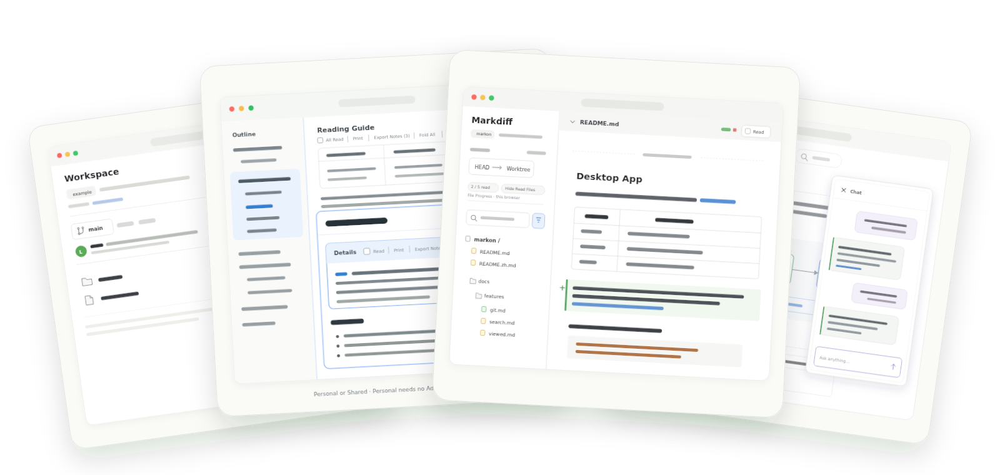

<p align="center">
  <picture>
    <source media="(prefers-color-scheme: dark)" srcset="docs/public/logo-dark.svg">
    
  </picture>
</p>

<h1 align="center">Markon</h1>

<p align="center"><strong>让人与 Agent 在文档中达成共识。</strong></p>

<p align="center">
  <a href="README.md">English</a> ·
  <a href="https://kookyleo.github.io/markon/">产品与文档</a> ·
  <a href="https://kookyleo.github.io/markon/download">下载</a> ·
  <a href="https://github.com/kookyleo/markon/releases/latest">发布版本</a>
</p>



设计从来不是一次写成，而是在阅读、质疑、修改与再审阅中逐步收敛。Markon 把本地 Markdown、目录上下文与 Git 历史放进同一个工作区，让人与 Agent 围绕真实文本一起审阅、一起改进，并在下一轮只关注真正发生的变化——直到 Spec 成为共识。

<p align="center"><strong><a href="https://kookyleo.github.io/markon/">查看 Markon 如何融入完整工作流 →</a></strong></p>

## Features

- [**Markdown 渲染（Markdown）**](https://kookyleo.github.io/markon/features/rendering) — GFM、Alerts、脚注、Emoji、KaTeX、Mermaid、PlantUML、D2、Graphviz、Vega 等。
- [**统一查找与搜索（Spotlight / Search）**](https://kookyleo.github.io/markon/features/search) — 在当前工作区内搜索文件名、路径、标题与正文。
- [**批注（Annotate）**](https://kookyleo.github.io/markon/features/annotations) — 高亮 Highlight、删除线 Strike、文字批注 Note、批注导航 Navigate 与撤销重做 Undo / Redo。
- [**进度标记与折叠（Progress / Fold）**](https://kookyleo.github.io/markon/features/viewed) — 通过已读（Read）／全部已读（All Read）复选框记录章节进度，并折叠已读内容。
- [**Git & Markdiff**](https://kookyleo.github.io/markon/features/git) — 用渲染结果或原始源码审阅工作区改动、提交、分支与标签。
- [**源码编辑（Edit）**](https://kookyleo.github.io/markon/features/edit) — 从渲染选区直达 Markdown 源码，对照预览完成修改。
- [**同步演示（Live）**](https://kookyleo.github.io/markon/features/live) — 在演示中同步页面、阅读位置、Section 焦点与文字选区。
- [**共享批注与阅读进度（Share）**](https://kookyleo.github.io/markon/advanced/shared-annotations) — 在多个浏览器之间同步批注与章节进度标记。
- [**工作区 AI（Workspace AI / Chat）**](https://kookyleo.github.io/markon/features/chat) — 调查文件、引用出处，并提出需要用户批准的修改。
- **导出与打印（Output）** — [导出文字批注（Export Notes）](https://kookyleo.github.io/markon/features/export)为 Markdown，或[打印（Print）](https://kookyleo.github.io/markon/features/print)整页与章节。

阅读、Search、Annotate、Progress、Git 审阅、Export Notes 与 Print 是基础能力。工作区仅为 **Edit · Chat · Live · Share** 提供高级开关；通过工作区门禁后即可 Personal 审阅，Share 用于切换共同审阅数据。

## 即刻开始

桌面版支持 macOS、Windows 与 Linux，并已随附后台服务：

**[下载 Markon](https://kookyleo.github.io/markon/download)**

终端或服务器环境可通过 Cargo 安装 CLI 与后台服务：

```bash
cargo install markon markond

markon README.md   # 打开单篇文档
markon docs/       # 打开目录工作区
markon -b          # 打开当前目录
```

接下来可以阅读[五分钟上手](https://kookyleo.github.io/markon/guide/getting-started)、[安装说明](https://kookyleo.github.io/markon/guide/installation)或[命令行参考](https://kookyleo.github.io/markon/guide/cli)。

## 数据与隐私

渲染、搜索、Git 检查、批注、Progress 与 Live 都在运行 Markon 的机器上完成。Workspace AI 是可选功能，只有它实际读取的上下文会发送给你配置的 Provider；其工具只能访问工作区，不能执行命令，每次写入建议都必须由用户批准。完整边界请阅读[数据与隐私](https://kookyleo.github.io/markon/advanced/data-and-privacy)和[访问与权限](https://kookyleo.github.io/markon/features/access)。

## 开发

```bash
npm install
npm run build
cargo build

scripts/quality-gate.sh
```

浏览器资源以 TypeScript bundle 的形式嵌入 `markon-core`。质量门禁会执行 Rust 格式检查、Clippy、Rust 测试、TypeScript 检查与 Vitest。架构及持久化兼容约束见 [ARCHITECTURE.md](ARCHITECTURE.md)，产品能力名称和术语边界见 [PRODUCT_NAMING.md](PRODUCT_NAMING.md)。

## 项目

- [在线文档](https://kookyleo.github.io/markon/)
- [Issues](https://github.com/kookyleo/markon/issues) 与 [Discussions](https://github.com/kookyleo/markon/discussions)
- [发布流程](RELEASE.zh.md)

版权所有 © 2025-至今 kookyleo。基于 [Apache License 2.0](LICENSE) 开源发布。再分发与衍生作品必须保留 [`NOTICE`](NOTICE)，并遵守 Apache-2.0 第 4 条要求；`Markon` 名称及标识仍归作者所有。

Markon 基于 [Supramark](https://github.com/kookyleo/supramark)，并受到 [go-grip](https://github.com/kookyleo/go-grip)与 [GitHub Markdown CSS](https://github.com/sindresorhus/github-markdown-css)的启发。
